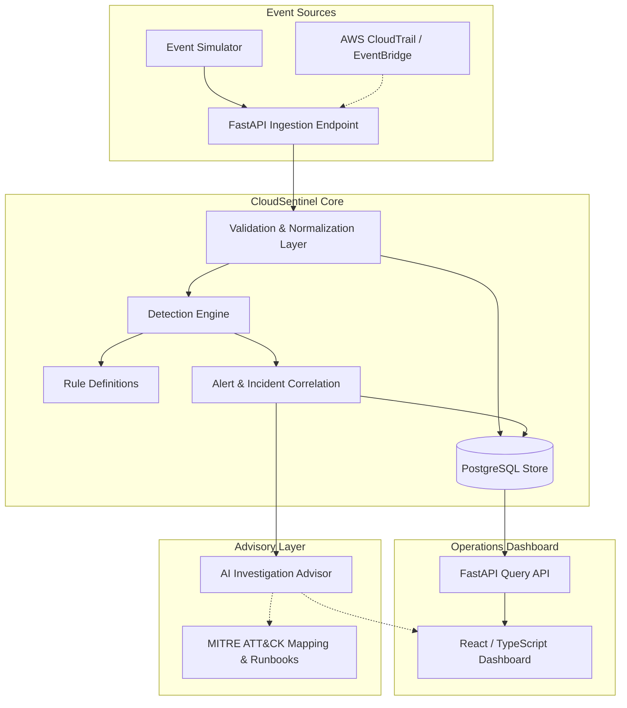

# CloudSentinel Architecture

## System Overview

CloudSentinel is an event-driven cloud threat detection and incident response architecture designed to process simulated and real AWS security events.

## Architectural Pillars

### 1. Ingestion & Normalization
- Ingests raw cloud audit logs (CloudTrail, GuardDuty, simulated attacker payloads).
- Validates payload schemas using Pydantic models.
- Normalizes disparate vendor formats into a canonical security event representation (event ID, UTC timestamp, source IP, principal identity, action, resource, region).
- Enforces idempotent ingestion using unique event hashes / UUIDs to prevent duplicate alert storms.

### 2. Deterministic Detection Engine
- Operates on codified detection rules written in Python.
- Rules are version-controlled, unit-tested with synthetic true/false positive event fixtures, and executed against incoming event streams.
- Explicit severity scoring: `INFO`, `LOW`, `MEDIUM`, `HIGH`, `CRITICAL`.

### 3. Correlation & Incident Lifecycle
- Correlates temporally clustered or identity-linked alerts into high-context **Incidents**.
- Reduces alert fatigue for security operations center (SOC) analysts.

### 4. Human-in-the-Loop AI Enrichment
- Non-destructive AI integration.
- Analyzes incidents to provide summaries, likely attack vectors, and step-by-step remediation suggestions for human analyst review.
- Never performs automated destructive actions (such as terminating instances or deleting accounts).

### 5. Storage & Persistence
- PostgreSQL for structured relational queries, ACID guarantees on event dedup, and indexing on key query dimensions (principal, source IP, time ranges).
